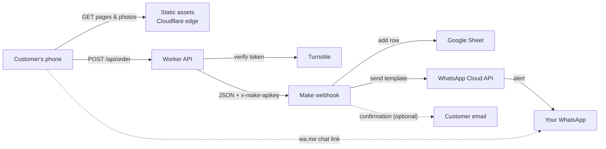
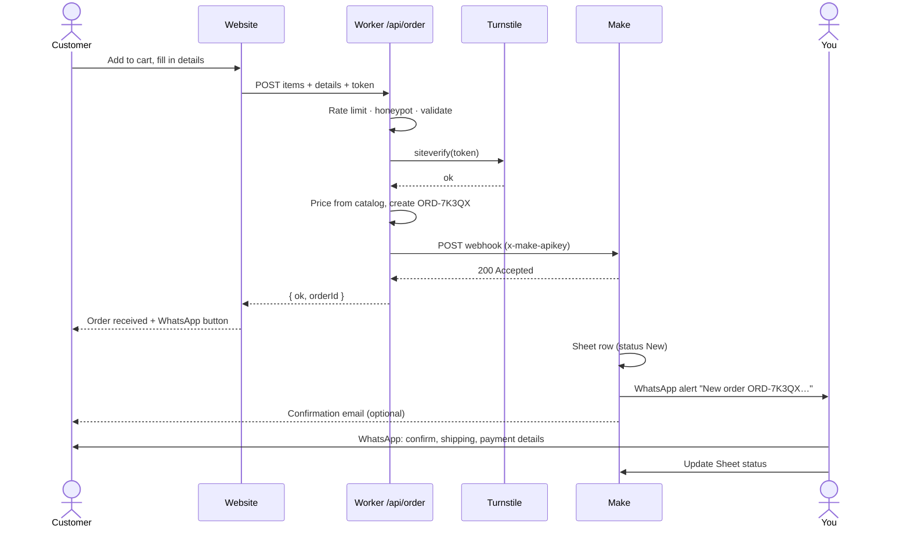

# Crochet Shop — Architecture & Order Workflow

**Status:** v0.3 (2026-10-21). Round 1 is built: static site, cart, ordering through WhatsApp, 15 sample products. The open questions in §14 still apply.

**Since v0.2 (2026-10-21):** the site is also the demo for selling done-for-you shops to other handmade sellers. It adds a demo banner (`src/components/DemoBanner.astro`, on while `demo.enabled` is true in `src/data/settings.json`), two sales pages built from `src/components/SellerOffer.astro` (`/for-sellers/` in ₹ and `/for-sellers/international/` in USD, with prices in `src/data/offers/*.json`), and `npm run starter` (`scripts/make-starter.mjs`), which makes a client copy without the demo parts, the Unsplash photos or the demo's Cloudflare settings. Deployment is in [DEPLOY.md](DEPLOY.md); the plan for selling is in [OUTREACH.md](OUTREACH.md) and [ROADMAP.md](ROADMAP.md).
**Visual version (with diagrams):** https://claude.ai/code/artifact/73687ba7-b604-422d-b84c-fe358e67673c

---

## 1. Goals and constraints

- Show handmade crochet products (about 15 today; the number changes with inventory).
- Customers send an **order request**. No online payment for now.
- Every order lands on **your WhatsApp** (via Make) and in a **Google Sheet** order book.
- Hosted on **Cloudflare Workers**, running on free tiers. The domain is the only fixed cost.
- **Sample crochet photos** until your real photos are ready.
- Mobile first. Most visitors will arrive from Instagram or WhatsApp on a phone.

Not in scope yet: payments, customer accounts, live stock counts, an admin dashboard.

---

## 2. Pages

| # | Page | URL | Job | Main content |
|---|------|-----|-----|--------------|
| 1 | Home | `/` | Make a first impression and send people to the shop | Hero photo and tagline, featured pieces, shop by category, how ordering works (3 steps), reviews, Instagram link |
| 2 | Shop | `/shop` | Browse everything | Product grid, category filters, price sort, badges: *Ready to ship*, *Made to order*, *Sold out* |
| 3 | Product | `/shop/<product>` | Help people decide, then capture the choice | Photo gallery, price, availability and lead time, options (colour/size), size, materials, care, **Add to cart**, **Ask on WhatsApp**, related pieces |
| 4 | Cart | `/cart` | Review pieces and collect the order request | Cart items with quantity and remove, name, WhatsApp number, email (optional), address and PIN code, gift note, notes, consent checkbox, **Send order on WhatsApp** (Round 1) or **Send order request** (Round 2, with bot check) |
| 5 | Order received | `/order/received` | Confirm the request and explain next steps | Order ID (e.g. `ORD-7K3QX`), summary, what happens next, **Send order on WhatsApp** button |
| 6 | Custom orders | `/custom-orders` | Take commissions | Past custom work, how it works, form: idea, colours, size, needed-by date, budget |
| 7 | About | `/about` | Build trust | Your story, process photos, yarns you use, why handmade takes time |
| 8 | Contact | `/contact` | Answer general questions | Contact form, WhatsApp and Instagram links, usual reply time |
| 9 | FAQ | `/faq` | Cut down repeat questions | Ordering, payment, shipping time and charges, customisation, care, returns |
| 10 | Policies | `/policies/shipping`, `/returns`, `/privacy`, `/terms` | Legal basics and trust | Short, plain language. Payment providers usually check these when you apply later. |
| 11 | Not found | (any bad link) | Recover gracefully | "Dropped a stitch" message, links to Shop |

**On every page:** header (logo, Shop, Custom orders, About, Contact, and a cart button with the item count that opens a slide-out cart), a floating WhatsApp button on mobile, and a footer (policies, Instagram, WhatsApp, email).

**Main path:** Home or Shop → Product → **Add to cart** (slide-out cart) → Cart → Order received → WhatsApp chat.

---

## 3. System architecture



| Piece | Role |
|-------|------|
| Cloudflare Worker + Static Assets | Serves the prebuilt site. Two server endpoints (`/api/order`, `/api/enquiry`) validate forms and forward them to Make. Static asset requests are free and don't use Worker invocations. |
| Cloudflare Turnstile | Free bot check on every form, verified on the server |
| Make (1 scenario) | Webhook → router → Sheet row, WhatsApp alert, emails |
| WhatsApp Business Platform | Sends the alert from a business sender number to your personal WhatsApp |
| Google Sheet | Order book with a status column, i.e. your lightweight CRM |
| GitHub + Workers Builds | Push to deploy, with preview URLs for branches |
| Cloudflare Web Analytics | Visitor stats with no cookies and no banner |

---

## 4. Stack and repo layout

- **Astro** builds every page as static HTML at deploy time, so pages are fast, SEO-friendly and ship almost no JavaScript. Its image pipeline turns each photo into responsive WebP/AVIF.
- **`@astrojs/cloudflare` adapter:** the whole site deploys as one Worker. Only the API routes run on demand (`export const prerender = false`).
- **Small client scripts** only where needed: cart (localStorage) and slide-out cart, gallery, filters, form submit.
- **Zod schemas** are shared by the browser form and the API.

```
crochet-website/
├─ docs/ARCHITECTURE.md
├─ src/
│  ├─ content/products/<product>/   # index.md + photos. One folder per product.
│  ├─ components/                   # ProductCard, Gallery, OrderBag, WhatsAppButton…
│  ├─ layouts/
│  ├─ pages/
│  │  ├─ index.astro, about.astro, contact.astro, faq.astro, custom-orders.astro, 404.astro
│  │  ├─ shop/index.astro, shop/[slug].astro
│  │  ├─ cart.astro, order/received.astro
│  │  ├─ catalog.json.ts                     # live names, prices and availability for the cart
│  │  ├─ policies/[slug].astro
│  │  └─ api/order.ts, api/enquiry.ts        # Round 2: run in the Worker
│  ├─ lib/        # schemas, turnstile, make client, order-id, formatting
│  └─ site.config.ts   # shop name, WhatsApp number, socials, shipping text
├─ public/        # favicon, robots.txt
├─ astro.config.mjs
└─ wrangler.jsonc
```

---

## 5. Product catalog and inventory

The product count will change with your inventory, so products are **data, not pages**. Add a folder and a product page appears. The shop grid, categories, sitemap and related items all rebuild themselves.

```yaml
# src/content/products/sunflower-tote/index.md
---
name: Sunflower Tote Bag
price: 1200
category: bags
status: available        # available | made-to-order | sold-out | hidden
leadTime: Ships in 3–5 days
options:
  - name: Colour
    values: [Mustard, Sage, Cream]
photos:
  - src: ./tote-1.jpg
    alt: Mustard tote with three crochet sunflowers
dimensions: 35 × 40 cm
materials: 100% cotton yarn, fabric lined
care: Hand wash cold, dry flat
featured: true
sample: true             # sample photo; must be replaced before launch
---
A roomy, sturdy tote with hand-stitched sunflowers…
```

| You want to… | Do this |
|--------------|---------|
| Add a product | Add a folder (text file + photos) |
| Sell out a piece | `status: sold-out`. The page stays up with an **Ask for a custom one** button, so shared links still work. |
| Pause a product | `status: hidden`. It disappears from the site but the folder stays for later. |
| Remove permanently | Delete the folder. Old links show the friendly 404. |

**How edits go live:** edit → commit to GitHub → Workers Builds redeploys (about 1–2 min).
- Now: edit files on GitHub's website.
- When wanted: a free Git-based admin UI (Pages CMS or Sveltia CMS) with forms, photo upload and sold-out toggles, usable from your phone. It commits to the same repo, so nothing else changes.

**Safety:**
- The order API checks every item against the deployed catalog. It uses catalog prices (never prices sent by the browser) and rejects sold-out or hidden items.
- If something in a saved cart has since sold out, the cart flags it and the order can't be sent until it's removed.
- The production build fails while any product still has `sample: true`, so you can't launch with stock photos by accident.

**Sample photos:** free-licence crochet photos (Unsplash/Pexels), resized to about 1600 px and stored in each product folder. I'll list the exact files for your OK before downloading.

---

## 6. Order workflow

**Cart.** The cart is saved in the customer's browser (localStorage). It stores only product id, chosen options and quantity, never prices. The slide-out cart and the cart page read current names, prices and availability from `/catalog.json`, which is generated with every build, so a price change or a sell-out shows as soon as the site redeploys. Customers can add up to 10 of each piece.

**Order modes** (`orderMode` in `src/site.config.ts`):
- `'whatsapp'` (Round 1, live now): the cart page creates the order ID and opens WhatsApp with the full order, addressed to you. No server is involved.
- `'api'` (Round 2): the cart page sends the order to `/api/order`, as in the flow below. The WhatsApp button stays as the fallback.



**Order ID:** `ORD-` followed by 5 characters from an alphabet without look-alikes (no 0/O, 1/I/L), so it's easy to read out over the phone. The prefix can become your shop's initials.

**Statuses** (Sheet dropdown): `New → Confirmed → Paid → Making → Shipped → Delivered`, or `Cancelled`.

**When something fails:**

| Problem | What the customer sees | Is the order safe? |
|---------|------------------------|-------------------|
| Invalid field | Error under that field | Not sent yet |
| Bot check fails | "Please try again" and a fresh check | Not sent yet |
| Too many attempts (429) | "Wait a minute and retry" | Not sent yet |
| Item sold out (409) | Item flagged in the cart | Not sent yet |
| Make unreachable (502) | **Send this order on WhatsApp** button with the full order prefilled | Yes, it reaches you directly |
| WhatsApp step fails inside Make | Nothing (already confirmed) | Yes: the Sheet row exists, a backup email goes to you, and Make keeps the incomplete run to retry |

---

## 7. API contracts

**`POST /api/order`** (browser → Worker). Prices are never sent from the browser.

```json
{
  "items": [{ "productId": "sunflower-tote", "option": "Mustard", "qty": 1 }],
  "customer": { "name": "Sample Customer", "whatsapp": "+91 98765 43210", "email": "" },
  "delivery": { "method": "ship", "address": "12 Example Street", "city": "Jaipur", "pincode": "302001" },
  "giftNote": "", "notes": "", "consent": true,
  "website": "",
  "turnstileToken": "…"
}
```
`website` is the honeypot field. Responses: `200 {ok, orderId}` · `400 {errors}` · `403` · `409 {unavailable}` · `429` · `502`.

**`POST /api/enquiry`**: `{ kind: "contact" | "custom", name, whatsapp, email, message, custom?: { idea, colours, size, neededBy, budget }, turnstileToken }` → `{ ok, enquiryId }`.

**Worker → Make** (one webhook for both):

```json
{
  "type": "order",
  "env": "production",
  "orderId": "ORD-7K3QX",
  "createdAt": "2026-09-13T10:24:00+05:30",
  "customer": { "name": "…", "whatsapp": "+919876543210", "email": "…" },
  "delivery": { "method": "ship", "address": "…", "city": "Jaipur", "pincode": "302001" },
  "items": [{ "id": "sunflower-tote", "name": "Sunflower Tote Bag", "option": "Mustard", "qty": 1, "unitPrice": 1200, "lineTotal": 1200 }],
  "itemsSummary": "1× Sunflower Tote Bag (Mustard)",
  "subtotal": 1200,
  "subtotalText": "₹1,200",
  "currency": "INR",
  "giftNote": "", "notes": "",
  "chatLink": "https://wa.me/919876543210"
}
```

`itemsSummary` and `subtotalText` come pre-built as **single lines**, because WhatsApp template values can't contain line breaks, tabs or more than 4 spaces in a row. Full multi-line details go to the Sheet and the backup email.

---

## 8. Make scenario

One scenario, which also keeps you inside the free plan's 2 active scenarios.

```
Custom webhook (API key auth, x-make-apikey)
└─ Router                                   (routers use no credits)
   ├─ Route "order"   filter: type = order
   │  ├─ Google Sheets › Add a row            → "Orders" tab
   │  ├─ WhatsApp Business Cloud › send template new_order_alert → you
   │  │     (error handler → email to you, keep run for retry)
   │  └─ Email › confirmation to customer    (only if email given)
   └─ Route "enquiry" filter: type = contact | custom
      ├─ Google Sheets › Add a row            → "Enquiries" tab
      └─ WhatsApp Business Cloud › send template new_enquiry_alert → you
```

- Put an `env = production` filter before the WhatsApp steps so test orders from preview deployments don't ping you.
- Scenario settings: schedule **Immediately**, *allow storing incomplete executions* on, error notifications on.
- **Budget:** about 4 credits per order and 3 per enquiry. The free plan's 1,000 credits/month covers roughly 200 orders. The free plan has a 15-minute minimum interval for *scheduled* runs; confirm during setup that the webhook scenario runs immediately on your plan.

**Orders sheet columns:** Order ID · Received · Status · Name · WhatsApp · Email · Items · Subtotal · Shipping · Total · Delivery · Address · PIN · Gift note · Notes · Payment ref · Tracking · Internal notes

**WhatsApp templates** (Utility category, need Meta approval):
- `new_order_alert`: "New website order {{1}} from {{2}} ({{3}}). Items: {{4}}. Total: {{5}}. Delivery: {{6}}. Full details are in your Orders sheet."
- `new_enquiry_alert`: "New {{1}} enquiry from {{2}} ({{3}}): {{4}}. Reply on WhatsApp when you can."

---

## 9. WhatsApp alerts: options

An automated WhatsApp message needs a **sender number on the WhatsApp Business Platform**, and it can't be the same number that receives the alert.

| Option | How it works | Cost | Setup | Verdict |
|--------|--------------|------|-------|---------|
| **A. Official Cloud API via Make** | Make's WhatsApp Business Cloud module sends an approved template from a business number to your personal WhatsApp | Small per-message fee for templates outside a 24 h chat window (Meta rate card, by country) | Meta Business portfolio, a sender number, template approval (Make's new connection flow creates the token for you) | **Recommended** for automated alerts |
| **B. Customer taps wa.me link** | Order text opens prefilled in the customer's WhatsApp, addressed to you | Free | None | **Always on** as the companion and fallback. Starts the chat directly, but relies on the customer pressing send. |
| C. Telegram bot via Make | Make Telegram module | Free | About 10 min | Good stopgap if Meta setup stalls |
| D. Unofficial WhatsApp gateways | Automate WhatsApp Web or third-party bots | Free/cheap | Low | **Avoid.** Risk of a number ban, unreliable, and order data passes through unknown services. |

**Sender number choices for A:** (1) a cheap second SIM used only for alerts; (2) your existing WhatsApp Business app number via *coexistence*, where available in your country, with alerts going to a personal number; (3) Meta's free test number, which is fine for trying it out but messages at most 5 pre-approved recipients and its templates don't carry over.

**Until A is live:** Make emails you instead, and B works from day one.

---

## 10. Security and privacy

- The Make webhook URL and API key are **Worker secrets only** and never reach the browser.
- Turnstile token verified on the server, plus a honeypot field and a same-origin check.
- Rate limit of 5 submissions per minute per IP, using the Workers rate-limiting binding (a best-effort guard).
- Strict validation and length limits; plain text only.
- Prices recalculated from the catalog; unknown, sold-out or hidden items rejected.
- Personal data lives only in your Google Sheet and Make logs. The privacy page says so.
- Security headers (CSP, Referrer-Policy, etc.).

---

## 11. Deployment and running costs

- GitHub repo → **Workers Builds**: push to `main` deploys production, other branches get preview URLs.
- Secrets: `TURNSTILE_SECRET_KEY`, `MAKE_WEBHOOK_URL`, `MAKE_WEBHOOK_KEY`. Public vars: WhatsApp number, Turnstile site key.
- Custom domain attached to the Worker; Cloudflare Web Analytics on.

| Item | Cost |
|------|------|
| Workers (free plan), static assets, Turnstile, Web Analytics | Free |
| Make free plan (1,000 credits/month, 2 active scenarios) | Free |
| Google Sheets | Free |
| WhatsApp template alerts (option A) | Small per-message fee |
| Domain | About the yearly registration price |

---

## 12. Process additions (suggested)

1. **Order ID everywhere:** site, Sheet, WhatsApp, email.
2. **Pay after confirmation:** you confirm on WhatsApp, then share UPI/bank details. Keep the payment message and QR as a WhatsApp Business **quick reply**.
3. **WhatsApp Business labels** that mirror the Sheet statuses (New, Paid, Shipped).
4. **Availability badges and lead times** (ready to ship vs made to order).
5. **Gift note** field. Crochet pieces are often gifts.
6. **Link previews:** each product gets its own title, description and photo, so links shared on WhatsApp or Instagram look good.
7. **WhatsApp consent checkbox**, needed if you ever message customers through the API.
8. **Test mode:** preview deployments are tagged `env: preview` and never ping your phone.

**Later:** status-change messages to customers, reviews, payment links (Razorpay/Stripe), an admin CMS, live stock without redeploys.

---

## 13. Build plan

| Round | Deliverable |
|-------|-------------|
| 1 | **Done.** Project setup, design system, all 11 pages with 15 sample products, cart (slide-out and cart page), orders sent through WhatsApp |
| 2 | Worker API for orders and enquiries (validation, Turnstile, rate limit), then switch to `orderMode: 'api'` |
| 3 | Make scenario, Sheet, email; end-to-end test with Make's free options |
| 4 | WhatsApp Cloud API sender and template approval |
| 5 | Your real products and photos, policies text, domain, analytics, launch checklist |

---

## 14. Decisions and open questions

**Answered (2026-09-13)**
- **Brand:** the shop is called Loopwork. The logo draws the "oo" as two interlocked chain stitches, and the favicon shows those loops on a berry square.
- **Location and currency:** India, prices in ₹ (INR), payment by UPI or bank transfer.
- **Cart:** customers can add several pieces and send them in one request.
- **Custom orders:** yes, so the Custom orders page stays.
- **WhatsApp:** you use a WhatsApp Business app account.
- **Editing products:** through a local admin page at `/admin` that only exists while the site runs on your computer (`npm run dev`). Changes are saved to the project files and go live the next time you deploy.
- **Accounts:** you have a domain, GitHub, Cloudflare and a Google account.

**Still open**
1. **Shipping charges:** flat rate, free above an amount, or quoted per order? *(For now: quoted on WhatsApp.)*
2. **Alert sender for Round 4:** connect your WhatsApp Business number to the Cloud API through coexistence (alerts then go to a personal number), or use a second number just for alerts?
3. **Details to fill in:** your WhatsApp number, email, Instagram link and domain. Enter them under Shop settings in the admin.
